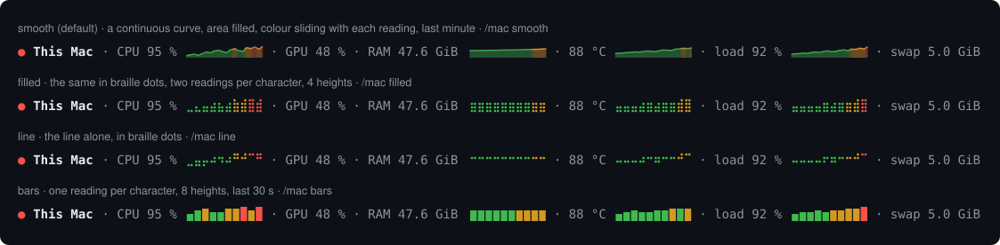
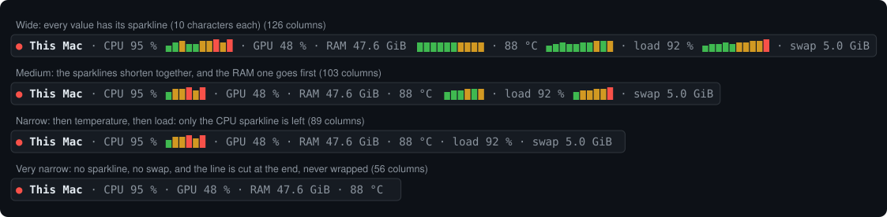

# mac-sonde

A small line above the Claude Code prompt that shows how hard your Mac is working, refreshed every 10 seconds by default:



<sub>Illustrations drawn from the mod's own drawing rules with sample readings, not screenshots.</sub>

- **CPU**, **GPU**, **RAM**, **temperature** (optional, see below), **load** and **swap**, measured the way CleanMyMac shows them (see [How each value is measured](#how-each-value-is-measured)).
- Each value is followed by a sparkline coloured by level: green below 70 %, orange from 70 %, red from 90 % (for the temperature: orange from 85 °C, red from 95 °C, height from 30 °C to 100 °C).
- The dot at the start sums it up with the same thresholds.
- The sparklines start empty at each new session.
- `/mac` hides the line, and shows it again. The choice is remembered across sessions.
- After `/mac `, start a word and the prompt box suggests the ones it understands (`/mac s` → `smooth`, `slow`), each with a short description.

**macOS only.** It reads the system with `sysctl`, `vm_stat`, `ioreg` and `iostat`, which ship with macOS; nothing to install, no administrator rights, nothing sent anywhere. All open sessions share one reading, kept in `~/Library/Caches/mac-sonde/releve.json` (see [Many sessions](#many-sessions)). On another system the line shows "no reading".

> Claude Code mods are in early access: the API may change and break this mod until it is updated.

## How each value is measured

Monitoring apps disagree because they do not count the same thing. Since 1.4.0, mac-sonde follows CleanMyMac, the reference most people compare against.

| Value | What is counted | Read from |
| --- | --- | --- |
| CPU | Share of time all cores spent doing work over the last second (user + system), like `top`, Activity Monitor or CleanMyMac | `iostat -c 2 -w 1`: 100 % minus the idle share |
| RAM | Active + wired + compressed memory. Inactive pages, file cache and free pages are left out: macOS hands them back as soon as an app asks, which is what CleanMyMac calls "available" | `vm_stat`: `Pages active`, `Pages wired down`, `Pages occupied by compressor` |
| Temperature | The hottest CPU die sensor, rounded to the degree | the helper in `extras/` (see below) |
| Load | 1-minute load average divided by the number of cores: 100 % means every core is busy, more means tasks are waiting. It counts tasks waiting for the disk too, so it is not the CPU, and CleanMyMac does not show it | `sysctl vm.loadavg` |
| Swap | Swap space in use | `sysctl vm.swapusage` |
| GPU | Device utilisation reported by the graphics driver | `ioreg` |

Units: memory is in GiB (1 GiB = 1024³ bytes). CleanMyMac writes "Go"/"GB" but counts the same way: a 48 GiB Mac shows "48".

Why these choices, and what changed from 1.3.0:

- **CPU.** Up to 1.3.0, the CPU was the sum of each process's `%CPU` from `ps`. That figure is smoothed over about a minute, misses processes that already ended and part of the system time: under load it read 2 to 3 times lower than `top` (15 % against 44 % in one measurement). The new reading is the real share of the last second, so a reading takes about one second.
- **RAM.** Up to 1.3.0, the RAM followed Activity Monitor's "Memory used", which counts all app memory, inactive pages included. It read 4 to 5 GiB above CleanMyMac on a 48 GiB Mac. Active + wired + compressed is exactly CleanMyMac's "used" (48 − "available").
- **Temperature.** Up to 1.3.0, the helper wrote macmon's average of every sensor, truncated to the degree, every 15 s. Under load the hottest core runs 10 to 20 °C above that average (78 °C average against 96 °C in CleanMyMac). It now writes the hottest die sensor, every 5 s. A hot Apple Silicon chip near 100 °C under full load is normal: it slows itself down before any harm.
- **Swap** did not change: it already matched CleanMyMac.

## Four sparkline styles

| Style | Looks like | History shown |
| --- | --- | --- |
| `smooth` (default) | a real continuous curve, area filled, its colour sliding from one reading to the next; drawn as a small image | 20 readings, 3 min 20 s |
| `filled` | `⣀⣤⣶⣿`: the curve in braille dots, area filled, two readings per character, 4 heights | 20 readings, 3 min 20 s |
| `line` | `⣀⡠⠊`: the line alone, in braille dots | 20 readings, 3 min 20 s |
| `bars` | `▁▃▅█`: one reading per character, 8 heights | 10 readings, 1 min 40 s |

`smooth` is an image, which a terminal cannot draw: in a terminal session the line falls back to `filled`. The durations are at the default slow sampling rate (1 min and 30 s at the normal rate).

Pick one when you install the mod (the **Sparkline style** setting), and switch at any time:

```
/mac smooth
/mac filled
/mac line
/mac bars
```

The style you pick with `/mac` is remembered across sessions and wins over the install setting. `/mac` alone still hides or shows the line; an unknown word shows the help and changes nothing. The French names (`lisse`, `pleine`, `courbe`, `barres`) work too.

## Sampling rate

| Rate | One reading every |
| --- | --- |
| `slow` (default) | 10 s |
| `normal` | 3 s |

Pick one when you install the mod (the **Sampling rate** setting), or switch with `/mac slow` or `/mac normal`; the choice is remembered and wins over the install setting (`lent` and `normal` work too). There is no faster rate on purpose: each reading runs five system commands and watches the CPU for one second, and every open session redraws its line at each new reading. The `fast` rate (one reading per second) was removed in 1.5.0; a `fast` setting kept from an earlier version falls back to `slow`.

## Many sessions

The line costs little in one session, but every open session draws its own. Since 1.5.0, with many sessions open:

- **One reading for all sessions.** The first session that finds the shared reading out of date announces it is taking one, reads the Mac and stores the result in `~/Library/Caches/mac-sonde/releve.json`; the other sessions reuse it instead of reading the Mac themselves. Ten open sessions cost one reading every 10 s, not ten. A reading announced more than 3 s ago is taken as abandoned.
- **No redraw without a new reading.** A session redraws its line only when a new reading came in.
- If that file cannot be read or written, each session reads the Mac itself, as before 1.5.0.

## Narrow windows

The line always stays on one row. Each sparkline is 10 characters at most. When space runs out, the sparklines shorten together down to 5 characters, then drop one by one: RAM first, then temperature, then load, the CPU last. Then the swap goes. Past that, the line is cut at the end, never wrapped.



## Install

At the prompt of a Claude Code terminal session:

```
/plugin install mac-sonde --marketplace tiber76/mac-sonde
```

Answer `y` to add the marketplace, then pick a scope (Enter for your user). The line appears right away.

From a shell:

```bash
claude plugin install mac-sonde --marketplace tiber76/mac-sonde
```

In the Claude desktop app, where `/plugin` does not run: click + next to the prompt box, then Plugins, Add marketplace with `tiber76/mac-sonde`, then Add plugin.

## Settings

Run `/config` and look for the mac-sonde rows:

| Setting | Values | Default |
| --- | --- | --- |
| Language | `en` (English) or `fr` (français) | `en` |
| Sparkline style | `smooth`, `filled`, `line` or `bars` | `smooth` |
| Sampling rate | `slow` or `normal` | `slow` |
| Temperature file | path to a file, `~/` allowed | empty: no temperature |

## Temperature (optional)

macOS gives no temperature to ordinary commands, so mac-sonde reads it from a file you keep fresh. The file holds one line, the time in Unix seconds then the temperature in degrees Celsius:

```
1762620000 58.4
```

Decimals are allowed; the line rounds to the degree. A value older than 60 seconds is ignored, so the temperature disappears on its own if your tool stops.

On Apple Silicon, [macmon](https://github.com/vladkens/macmon) reads it without administrator rights. The `extras/` folder holds a helper script and a launchd service that keep `~/.mac-sonde/temperature.txt` up to date, every 5 seconds, with the hottest CPU die sensor (`PMU tdie…` in `macmon debug`), as CleanMyMac or iStat Menus show it. If macmon lists no die sensor for your chip, the helper falls back to macmon's average of every sensor, which reads lower under load.

```bash
brew install macmon
mkdir -p ~/.mac-sonde
cp extras/mac-sonde-temperature.sh ~/.mac-sonde/
sed "s|YOUR_HOME|$HOME|" extras/mac-sonde-temperature.plist > ~/Library/LaunchAgents/mac-sonde.temperature.plist
launchctl load ~/Library/LaunchAgents/mac-sonde.temperature.plist
```

Then set **Temperature file** to `~/.mac-sonde/temperature.txt` in `/config`. To stop it: `launchctl unload ~/Library/LaunchAgents/mac-sonde.temperature.plist`.

Coming from 1.3.0 or earlier, copy the new helper and restart the service, or the old average stays:

```bash
cp extras/mac-sonde-temperature.sh ~/.mac-sonde/
launchctl kickstart -k gui/$(id -u)/mac-sonde.temperature
```

Why a background service: run from inside Claude Code's command sandbox, macmon cannot subscribe to the sensors.

## Develop

```bash
claude plugin test .
claude plugin validate . --profile directory
claude --plugin-dir .
```

## License

MIT, see [LICENSE](LICENSE).
